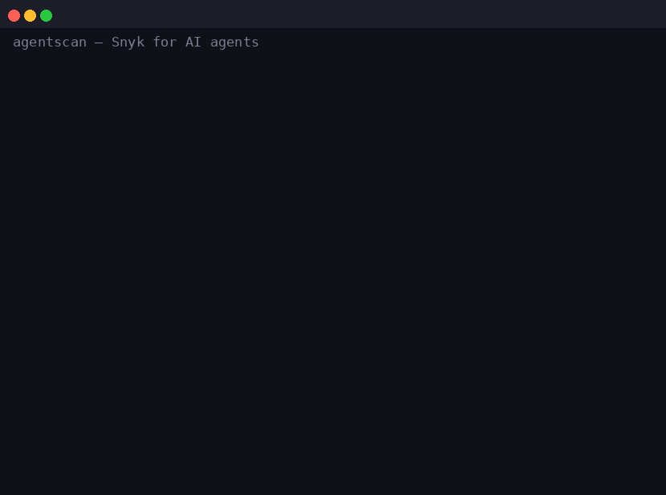

<p align="center">
  
</p>

# agentscan

**Snyk for AI agents.** A static security scanner for AI agent assets: skill
packs (Claude Code / Codex / Cursor), MCP server code, and agent instruction
docs (`AGENTS.md`, `CLAUDE.md`, `.cursorrules`, `.mcp.json`, `.env`).

Everyone is now installing skills into their agents. A skill is third-party
code *and* instructions. A malicious one ships prompt injection, hardcoded
keys, `curl | sh`, and exfiltration to a raw IP — and your agent runs it with
your permissions.

agentscan catches that **before** the skill is loaded: fast, offline,
deterministic rules — no LLM, no API key, zero dependencies — and every rule
is unit-tested against a fixture corpus.

## What it detects

| Family | Severity | Examples |
|---|---|---|
| `secret/*` | CRITICAL | AWS access keys, OpenAI / Anthropic / GitHub / Google / Slack / ServiceNow tokens, PEM private keys, GCP service-account JSON, JWTs |
| `injection/*` | CRITICAL / HIGH | "ignore all previous instructions", fetch-and-follow remote commands (English **and Vietnamese**), zero-width / invisible text, hidden HTML comments, white-on-white spans, base64 blobs, pastebin / ngrok URLs |
| `dangerous/*` | CRITICAL | `curl \| sh`, base64-decode-then-execute, `eval` of network-fetched content, `rm -rf ~` / `--no-preserve-root`, `chmod 777`, crontab persistence |
| `exfil/*` | MEDIUM | network sends in files that read env vars / local files, raw-IP URLs, abuse-prone TLDs (`.top` / `.xyz` / …) |
| `privilege/*` | HIGH / MEDIUM | `--dangerously-skip-permissions` in agent docs, "never ask for confirmation" (EN + VN), `allowed-tools: Bash(*)` in SKILL.md frontmatter |

The rule set is deliberately bilingual (EN/VN) and aimed at the agentic-skill
attack surface, not generic secret scanning.

## Install

```bash
pip install git+https://github.com/sinhduc01/agentscan.git
```

Python 3.10+. No other dependencies.

## Usage

```bash
agentscan ./path/to/skill-pack   # human-readable table
agentscan . --json               # machine-readable, for CI
agentscan . --fail-on medium     # exit 1 on >= medium (default: high)
```

Exit code `1` when a finding at or above the threshold is found, so it plugs
directly into CI, pre-install hooks, or a skill registry gate:

```yaml
- name: Scan agent assets
  run: agentscan skills/ .mcp.json AGENTS.md --fail-on medium
```

Example finding:

```
  CRITICAL  secret/aws-access-key              scripts/deploy.py:4
            AWS access key ID
            > AWS_KEY = "AKIAQ7…01
            fix: Rotate the key in IAM; move credentials to environment
                 variables or a secret manager.
```

## Why deterministic rules instead of an LLM?

- **Testable**: every rule has a fixture; the suite runs in 0.1 s.
- **Offline & free**: a pre-install security gate that needs an API key or a
  network call is not a gate.
- **Reproducible**: same input, same findings, no model drift.

The roadmap includes an optional LLM pass that explains *why* a skill is
risky and catches semantic injection the regexes can't see.

## Limitations (read before relying on this)

- Static analysis: obfuscated payloads (decode → exec in two stages across
  files) and purely semantic malice are out of scope.
- Heuristics produce false positives: a legitimate telemetry POST that reads
  an env var will be flagged `exfil/possible-exfiltration`.
- This is a first-pass filter, not a substitute for reviewing a skill's code.

## Development

```bash
pip install -e .
pytest
```

Layout: `agentscan/rules/` holds one module per rule family
(`secrets`, `injection`, `dangerous`, `exfil`, `privilege`); adding a rule is
one tuple in a module's `_PATTERNS` list plus a fixture line in
`tests/fixtures/`.

## Roadmap

- LLM deep-scan mode (opt-in, explains findings, catches semantic injection)
- more targets: Windows skill scripts (`.ps1` / `.bat`), Rust/Go MCP servers
- GitHub Action + pre-commit hook

## License

MIT — see [LICENSE](LICENSE).
